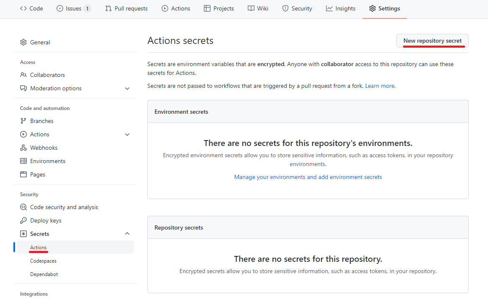

# Development

The notes below help for developing the library locally.

## Installation

Run the following commands to configure the library

> ⚠ Make sure to have Dapr installed

```bash
npm install
```

## Running the Library

The command below runs the build process and will rebuild each time we change a file. This comes in handy when checking issues.

```bash
npm run start:dev
```

## Publishing Package Package Maintenance

To publish a new package to [https://www.npmjs.com/package/@dapr/dapr](https://www.npmjs.com/package/@dapr/dapr) we need to do the following building and publishing steps.

For **building** a new version, we:

- update the version in `package.json` in the repo root, e.g. `3.4.0` for a final releaes or `3.4.0-rc.1` for a pre-release
- run `npm install` again to refresh lock file (it should now be dirty and part of the change list)
- verify the Dapr revision in [scripts/fetch-proto.js](../scripts/fetch-proto.js) and update if necessary
- run `node scripts/fetch-proto.js` from the repo root to sync the common, external runtime, and durabletask protos, then `npx buf generate` to regenerate bindings
- verify [build.yml](../.github/workflows/build.yml) env variables, especially the Dapr and Node versions to test against

PR this change into the right release branch, e.g. `release-3.4.0`. Merging to `master` branch should happen last.

The proto snapshots are pinned to dapr/dapr commit `6801e6d54e908e0f7625e2a467d40359c3eb77d6`
and dapr/durabletask-protobuf commit `89e5df3ffbbac9ac043997b109718db2c2b182b6`.
To fetch another tag, branch, or commit, set `DAPR_VERSION` before running the fetcher
(for example, `$env:DAPR_VERSION = "master"` in PowerShell).
The fetcher updates both `dapr/proto` and the packaged sources in `src/proto/dapr/proto`,
and only retrieves Dapr's `common/v1/common.proto`, `runtime/v1/*.proto`, and
the durabletask definitions from `dapr/durabletask-protobuf`. Set `DURABLETASK_VERSION`
to override the durabletask revision. Durabletask imports are rewritten to the local
`dapr/proto/durabletask/v1` path.
Bindings are generated with Protobuf-ES v2, which includes the service descriptors
used by ConnectRPC v2; separate legacy gRPC and ConnectRPC v1 bindings are not needed.

A custom script is utilized here since we have 2 libraries in one for HTTP and gRPC

For **publishing** the package, we simply cut a new release by:

- create a new release/tag in the dapr/js-sdk repo
  - for a final release the tag should look like `v3.4.0` and mark it as final official release. Generate release notes using the N-1 released version, e.g. using 3.3.1.
  - for a pre-release it should look like `v3.4.0-rc.1` and mark it as a pre-release
- verify the package is now uploaded to [https://www.npmjs.com/package/@dapr/dapr](https://www.npmjs.com/package/@dapr/dapr) and shows the new version

Publishing is automated in the CI/CD pipeline. Each time a version is release (GitHub ref starting with `refs/tags/v`) then the pipeline will deploy the package as described in [build.yml](../.github/workflows/build.yml).

## Running Tests

Tests are written per protocol layer: http or grpc. This is done because Dapr requires endpoints to be registered for for pubsub and bindings, making us having to start up the test, initialize those endpoints and then run. Since Dapr is a sidecar architecture, we thus have to start 2 test suites seperately. It requires the following containers:

- **EMQX:** Used for Binding Tests
  - Credentials: http://localhost:18083 (user: admin, pass: public)
- **MongoDB:** Used for State Query API

```bash
# Start Container
docker run -d --rm --name emqx -p 1883:1883 -p 8081:8081 -p 8083:8083 -p 8883:8883 -p 8084:8084 -p 18083:18083 emqx/emqx
docker run -d --rm --name mongodb -p 27017:27017 mongo

# Run Unit Tests
npm run test:unit:main
npm run test:unit:actors

# Start gRPC tests
npm run test:e2e:grpc

# Start HTTP tests
npm run test:e2e:http
```

Binary Store integration tests cover HTTP and gRPC against an authenticated
sidecar and the `BinaryStoreHarness` from `@dapr/testcontainer-node`. The harness
manages its own sidecar and in-memory component; its independent HTTP helpers
seed files for SDK downloads and verify SDK uploads, overwrites, and deletes.
The tests exercise the SDK in this checkout rather than the harness's published
SDK dependency, including binary data, empty files, and streams larger than 4 MiB.
They require Docker and Dapr runtime 1.19 or later (1.19.0-rc.3 or later for
prereleases):

```powershell
$env:DAPR_RUNTIME_VERSION = "1.19.0-rc.4"
npm run test:e2e:binarystore
```

They are part of `npm run test:e2e:all` and skip older runtime versions.
The Binary Store unit tests are included in `test:unit:http` and `test:unit:grpc`.

Actor reminder listing tests are included in the actor unit and HTTP actor E2E
suites (the latter exercises both HTTP and gRPC clients). The E2E test registers
multiple reminders across two actors and another actor type, verifies exact
actor-ID filtering, type-wide gRPC listing, data/timing conversion, and empty
results after cleanup. HTTP listing requires Dapr 1.19+ (tested with
1.19.0-rc.4); gRPC listing requires 1.17+. Older runtimes skip only the
unsupported transport's listing test.

```powershell
node .\node_modules\jest\bin\jest.js --runTestsByPath test\unit\actor\actorClientReminderList.test.ts --runInBand
$env:DAPR_RUNTIME_VERSION = "1.19.0-rc.4"
node .\node_modules\jest\bin\jest.js --runTestsByPath test\e2e\http\actors.test.ts --testNamePattern "lists all reminders" --runInBand
```

Workflow payload-reference tests are part of the existing workflow unit and E2E
suites. The integration tests require Docker, Dapr 1.19 or later, Git, and the
.NET 10 SDK. They run real JS and .NET workflow workers and exchange stored
references in both directions, not just hand-written envelope fixtures.
Coverage includes primitive JSON values, Unicode and escaped strings, optional
stage metadata, and byte-size/hash verification. A pass-through workflow in
each SDK forwards an oversized, staged reference to a nonexistent store,
proving that explicit reference contracts need neither payload access nor
JS-specific envelope fields. Both SDKs also reject corrupt and deleted payloads
originally written by either implementation.

```powershell
$env:DAPR_RUNTIME_VERSION = "1.19.0-rc.4"
node .\node_modules\jest\bin\jest.js --runTestsByPath test\e2e\workflow\payloads.test.ts --runInBand
```

The .NET fixture builds against the exact source commit from
dapr/dotnet-sdk#1934 (`5ae2908a059a25c9793a60fc3f45a8be1c22c522`), because
the published `1.19.0-rc.3` workflow package lacks the payload APIs. The test
fetches that revision into a temporary directory, builds the fixture, and removes
the source checkout. GitHub and NuGet access are needed for the first build.
Set `DAPR_DOTNET_SDK_PATH` to an existing checkout of that revision to reuse local
sources; the test does not modify or remove that checkout. The fixture's `bin`
and `obj` outputs are ignored. CI installs .NET automatically; older Dapr runtime
matrix entries skip this suite without requiring a .NET build.

## Setup GitHub actions

1. Fork the [js-sdk](https://github.com/dapr/js-sdk) repo to your GitHub account.
2. Go to `Settings` in the forked repo and click on `Secrets` -> `Action`:
   
3. Add secret variables for Dapr CI

| Secret         | Value                                                                                                                                                | Usage                                                                                                                      |
| -------------- | ---------------------------------------------------------------------------------------------------------------------------------------------------- | -------------------------------------------------------------------------------------------------------------------------- |
| DAPR_BOT_TOKEN | [Your Github Personal Access Token](https://docs.github.com/en/authentication/keeping-your-account-and-data-secure/creating-a-personal-access-token) | [dapr-bot.yml](https://github.com/dapr/js-sdk/blob/main/.github/workflows/dapr-bot.yml) uses it for administrative actions |
